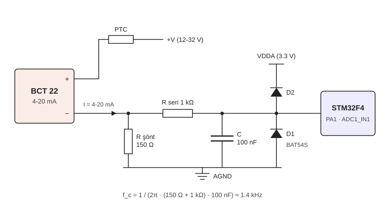

# BCT 22 Basınç Düğümü (4-20 mA → CAN)

ATEK BCT 22 basınç transmitterinin 4-20 mA çıkışını STM32F4 ile okuyup CAN hattına gönderen düğümün donanım notları ve yazılım modülü.

Bu modül BCT 22'nin **4-20 mA çıkışlı versiyonu** içindir: sensörün analog çıkışını bu kart ölçer ve CAN çerçevesine çevirir.

> Ekibin sipariş ettiği sensör CANopen versiyonudur. O versiyon doğrudan CAN hattına bağlanır ve onun için `canopen_pressure` modülü kullanılır. Bu modül, projeye 4-20 mA çıkışlı bir BCT 22 eklenirse gerekir; örneğin 1 ms cevap süresi isteyen bir ölçümde (bkz. 4.5).

Sensöre ait değerler ATEK'in BCT 22 teknik dokümanından (DS-BCT.001 Rev 5) alınmıştır. CAN fiziksel katmanında SN65HVD230 kullanılır. Yazılım STM32 HAL üzerine yazılmıştır; saat ve çevre birimi kurulumu CubeMX'te yapılır.

## İçindekiler

1. Dosyalar
2. Sistem özeti
3. Elektriksel altyapı
   - 3.1 4-20 mA akım döngüsü
   - 3.2 Besleme koşulu
   - 3.3 Şönt direnç ve ADC dönüşümü
   - 3.4 RC filtre ve kelepçe
   - 3.5 CAN fiziksel katmanı (SN65HVD230)
   - 3.6 Sensör bağlantısı ve datasheet notları
   - 3.7 Elektrik tarafında yapılacaklar
4. Kodsal altyapı
   - 4.1 Tasarım kararları
   - 4.2 CubeMX ayarları
   - 4.3 Kullanım: PN_Init ve PN_Process
   - 4.4 Modülün çalışma mantığı
   - 4.5 Ölçüm ve gönderim frekansı
   - 4.6 CAN mesaj formatı
   - 4.7 CAN ID seçimi
   - 4.8 Ayarlanabilir parametreler
   - 4.9 Ekip için entegrasyon kuralları
5. Test adımları
6. Sorun giderme

---

## 1. Dosyalar

```
pressure_node/
├── README.md
├── Inc/pressure_node.h      ayarlar, CAN ID'leri, durum bitleri
├── Src/pressure_node.c      ölçüm, ortalama, CAN gönderimi
└── docs/on_uc_devresi.svg   analog ön uç şeması
```

`pressure_node.h` projenin `Core/Inc`, `pressure_node.c` ise `Core/Src` klasörüne kopyalanır. CubeMX yeniden kod üretse de bu dosyalara dokunmaz.

Bu iki klasör CubeIDE projesinde zaten derleme ayarlarına ekli olduğu için başka bir ayar gerekmez. Dosyalar ayrı bir klasöre konursa o klasör proje ayarlarından include yoluna ve kaynak klasörlerine eklenmelidir; aksi halde derleme hatası alınır (bkz. 6).

---

## 2. Sistem özeti

```
   +V (12-32 V)
        |
      [PTC]
        |
   +---------+  4-20 mA  +-------------+  0.6-3.0 V  +-------------+  TX/RX  +------------+
   | BCT 22  |---------->| Şönt, RC ve |------------>|   STM32F4   |<------->| SN65HVD230 |<==> CAN hattı
   +---------+           |   kelepçe   |             | ADC1 + CAN1 |         +------------+
                         +-------------+             +-------------+
```

Sinyalin yolu:

1. Sensör, basınca göre döngü akımını ayarlar (4-20 mA).
2. Şönt direnç bu akımı gerilime çevirir (0.6-3.0 V).
3. RC filtre gürültüyü bastırır, kelepçe diyotları ADC pinini korur.
4. ADC gerilimi ölçer, yazılım basınca çevirip CAN çerçevesi oluşturur.
5. SN65HVD230 çerçeveyi diferansiyel CANH/CANL hattına basar.

---

## 3. Elektriksel altyapı

### 3.1 4-20 mA akım döngüsü

BCT 22 iki telli bir transmitterdir: besleme ve sinyal aynı iki telden geçer. Sensör, besleme kaynağı ve şönt direnç seri bağlı bir döngü oluşturur. Sensör bu döngüden geçen akımı basınca göre ayarlar:

- 0 basınç → 4 mA
- tam skala → 20 mA
- arası doğrusal

Bilgi gerilimde değil akımda taşınır. Seri bir döngüde akım her noktada aynıdır; bu yüzden kablo direnci ya da konnektördeki gerilim düşümü ölçümü bozmaz (besleme yeterli olduğu sürece). Kabloya binen gürültü de akımı pek değiştirmez. Roketteki gibi gürültülü bir ortamda bu önemli bir avantajdır.

Sıfır basıncın 0 mA değil 4 mA olması ("canlı sıfır") iki işe yarar: sensör elektroniği bu 4 mA ile beslenir ve 0 mA hiçbir zaman geçerli bir ölçüm olmaz. Akım 4 mA'nın belirgin şekilde altına düşerse hat kopmuş ya da sensör beslenmiyor demektir. Yazılım şu sınırları kullanır (NAMUR NE 43'teki mantığa benzer):

| Akım | Anlamı | Durum biti |
|---|---|---|
| < 3.6 mA | Hat kopuk / sensör beslenmiyor | `PN_ST_OPEN_LOOP` |
| 4 - 20 mA | Normal ölçüm | - |
| > 20.5 mA | Aralık dışı / kısa devre | `PN_ST_OVERRANGE` |

### 3.2 Besleme koşulu

Döngüdeki elemanlar seri olduğu için besleme gerilimi aralarında paylaşılır. Şönt, PTC, kablo ve konnektör gerilimin bir kısmını "yer", geri kalanı sensöre kalır. BCT 22'nin çalışması için kendi uçlarında **en az 8 V** görmesi gerekir ve bu en yüksek akımda da sağlanmalıdır, çünkü şöntteki düşüm akımla birlikte artar.

```
V_besleme,min = V_sensör,min + I_max × (R_şönt + R_kablo + R_PTC) + V_diğer
```

Kablo, PTC ve konnektör düşümleri ihmal edilirse:

| I_max | Şöntte düşen gerilim | Gereken en düşük besleme |
|---|---|---|
| 20 mA (tam skala) | 20 mA × 150 Ω = 3.0 V | 8 + 3.0 = **11.0 V** |
| 22 mA (aşırı basınç payı) | 22 mA × 150 Ω = 3.3 V | 8 + 3.3 = **11.3 V** |

Diğer düşümler için pay bırakınca pratik alt sınır **12 V** alınmalıdır.

Üst sınır: sensör uçlarında en fazla 32 V olabilir. En düşük akımda şöntte yalnızca ~0.6 V düştüğü için sensör beslemenin neredeyse tamamını görür. Bu yüzden besleme **32 V'u geçmemelidir**.

> **Sonuç: sensör hattının beslemesi 12 - 32 V aralığında olmalıdır.**

Besleme yetersiz kalırsa hata kendini ilginç bir şekilde gösterir: düşük basınçta (düşük akımda) her şey normal görünür, basınç arttıkça okuma bir değerde takılır kalır. Sebebi, yüksek akımda sensöre 8 V'tan az kalmasıdır.

Pille doğrudan besleme düşünülüyorsa:

| Kaynak | Dolu | Nominal | Boş (~3.3 V/hücre) | Uygun mu? |
|---|---|---|---|---|
| 3S LiPo | 12.6 V | 11.1 V | ~9.9 V | Hayır, boşaldıkça 11.3 V'un altına iner |
| 4S LiPo | 16.8 V | 14.8 V | ~13.2 V | Evet |
| 6S LiPo | 25.2 V | 22.2 V | ~19.8 V | Evet |
| Regüleli 24 V hat | 24 V | 24 V | 24 V | Evet |

3S ile çalışılacaksa sensör hattı bir yükseltici (boost) regülatörden beslenmelidir. Hangi çözümün seçileceği elektrik ekibinin kararıdır.

Şöntte harcanan güç normal çalışmada küçüktür: P = I² × R = (20 mA)² × 150 Ω = 60 mW. Arıza durumu için bkz. 3.4 (e).

Dokümanda akım çıkışı için yük değeri 250 Ω olarak verilmiştir. Akım çıkışlarında bu değer genellikle izin verilen en büyük yüktür; 150 Ω'luk şönt bu sınırın altında kalır. Dokümanda ≤ işareti olmadığı için kesin anlamı ATEK'e sorulabilir.

### 3.3 Şönt direnç ve ADC dönüşümü

ADC akım ölçemez, gerilim ölçer. Şönt direnç akımı Ohm yasasıyla gerilime çevirir: V = I × R. 150 Ω ile:

| Akım | Şönt gerilimi | Ham ADC (VREF = 3.3 V) | Basınç (100 bar sensör) |
|---|---|---|---|
| 3.6 mA | 0.540 V | 670 | hat kopuk |
| 4 mA | 0.600 V | 745 | 0 mbar |
| 12 mA | 1.800 V | 2234 | 50 000 mbar |
| 20 mA | 3.000 V | 3723 | 100 000 mbar |
| 20.5 mA | 3.075 V | 3816 | aralık dışı |

20 mA'de 3.0 V oluşur. 3.3 V referansın altında 0.3 V pay kalır, böylece 20 mA'nın biraz üstü de okunabilir ve aralık dışı durumu tespit edilebilir.

Şönt düşük tarafa (sensörün "−" ucu ile AGND arasına) konmuştur. Ölçülen gerilim doğrudan AGND'ye göre olduğu için fark yükselticisine gerek kalmaz.

Yazılımdaki dönüşüm zinciri:

```
V = ham × VREF / 4095
I = V / R_şönt
P = P_4mA + (I − 4 mA) / 16 mA × (P_20mA − P_4mA)
```

Çözünürlük:

- 1 ADC adımı = 3.3 V / 4096 ≈ 0.806 mV
- akım olarak: 0.806 mV / 150 Ω ≈ 5.37 µA
- 4-20 mA aralığı (16 mA) ≈ 2979 adım
- 100 bar sensörde 1 adım ≈ 33.6 mbar

Normal modda her çerçevede 160 okumanın ortalaması alınır (16 okuma × 10 ölçüm). Rastgele gürültü yaklaşık √160 ≈ 12.6 kat azalır.

**Sensörün kendi sınırları:** Sensörün iç çözünürlüğü 12 bittir; 4-20 mA çıkışı yaklaşık 16 mA / 4096 ≈ 3.9 µA'lik adımlarla değişir. Bu, ADC'nin 5.37 µA'lik adımıyla aynı düzeydedir. Ortalama almak gürültüyü azaltır ama sensörün kendi çözünürlüğünü artırmaz.

Doğruluk sıcaklığa bağlıdır:

| Sıcaklık | Doğruluk | 100 bar'lık sensörde |
|---|---|---|
| 25 °C | ±%0.5 T.S. | ±0.5 bar |
| 0 ... +70 °C | ±%1 T.S. | ±1 bar |
| -40 ... +85 °C | ±%2 T.S. | ±2 bar |

Rampada alınan dara (bkz. 4.6) sıfır kaymasını düzeltir ama aralık (span) hatasını düzeltmez.

**Önemli:** VREF hesabın içindedir. Kartın VDDA'sı 3.3 V değil de örneğin 3.0 V ise tüm okumalar ~%10 kayar ve 20 mA ADC'nin tavanına dayanır. VDDA kartta ölçülüp `PN_VREF_V` değerine yazılmalıdır.

### 3.4 RC filtre ve kelepçe



Şönt ile ADC pini arasındaki bu küçük devrenin üç görevi vardır: gürültüyü süzmek, ADC'yi beslemek ve pini korumak.

| Eleman | Başlangıç değeri | Görevi |
|---|---|---|
| R_seri | 1 kΩ | Filtrenin direnci, arıza akımını sınırlar |
| C | 100 nF | Filtrenin kondansatörü, ADC için yük deposu |
| D1, D2 | BAT54S (çift Schottky) | Pini AGND ile VDDA arasında tutar |

**Neden gerekli?** Şönt düğümü sensöre giden kabloya bağlıdır ve kablo bir anten gibi davranır. DC-DC dönüştürücülerin anahtarlama gürültüsü, ateşleme anındaki darbeler ve ESD bu kablodan karta girer. Korumasız bir ADC pini bunların hepsini doğrudan görür.

#### a) Alçak geçiren filtre

R_seri ve C birlikte bir RC alçak geçiren filtre oluşturur: yavaş değişen basınç sinyali geçer, hızlı değişen gürültü bastırılır.

Kesim frekansı hesaplanırken şönt de hesaba katılmalıdır. Sensör bir akım kaynağıdır (iç direnci çok yüksektir), bu yüzden filtre kaynak olarak yalnızca şöntü görür:

```
R_toplam = R_şönt + R_seri = 150 Ω + 1 kΩ   = 1150 Ω
τ        = R_toplam × C    = 1150 Ω × 100 nF = 115 µs
f_c      = 1 / (2π × τ)                      ≈ 1.38 kHz
```

f_c'nin üstünde sinyal, frekans her 10 katına çıktığında 20 dB zayıflar:

| Gürültü frekansı | Zayıflama (yaklaşık) |
|---|---|
| 100 kHz | ~1/72 (−37 dB) |
| 500 kHz | ~1/360 (−51 dB) |

**Basamak cevabı:** Basınç aniden değişirse filtre çıkışı üstel olarak yetişir. 12 bit doğrulukla (yarım adım hata ile) oturması için gereken süre:

```
t ≈ τ × ln(2^13) ≈ 9 × τ ≈ 1 ms
```

Normal modda (100 Hz) bu süre önemsizdir. Hızlı modda (1 kHz) ölçüm periyoduna yaklaşır; hızlı mod kullanılacaksa elektrik ekibi bunu değerlendirmelidir.

Not: Asıl bant sınırlaması yazılımdaki ortalama ile yapılır. RC filtrenin işi, ortalamanın temizleyemeyeceği yüksek frekanslı gürültünün (örtüşme, aliasing) ADC'ye ulaşmasını engellemektir.

#### b) ADC için yük deposu

STM32'nin ADC'si SAR tipindedir. Her okumada pini kısa bir süre içerideki ~4 pF'lık örnekleme kondansatörüne bağlar ve bu kondansatörün dolmasını bekler. Dışarıda kondansatör olmasaydı bu dolum 1150 Ω üzerinden yapılırdı ve örnekleme süresi kritik hale gelirdi.

100 nF bu küçük kondansatöre yükü anında verir. Yük paylaşımında oluşan hata en kötü durumda:

```
ΔV / V ≈ 4 pF / 100 nF = 1/25000
```

yani bir ADC adımının çok altındadır. Bu sayede 144 çevrimlik örnekleme süresi rahatça yeter ve kaynak direnci okumayı bozmaz.

#### c) Kelepçe diyotları (BAT54S)

BAT54S, tek kılıfta seri bağlı iki Schottky diyottur. Orta ucu sinyale, diğer uçları AGND ve VDDA'ya bağlanır:

| BAT54S pini | Bağlantı |
|---|---|
| 1 | AGND |
| 2 | VDDA |
| 3 | Sinyal (ADC pini tarafı) |

Normal çalışmada (0 - 3.3 V) iki diyot da ters kutuplanmıştır ve devrede yok gibidir. Sinyal VDDA + ~0.3 V'u geçerse D2 iletime geçer ve fazla akımı VDDA hattına aktarır. Sinyal −0.3 V'un altına inerse D1 iletime geçer ve AGND'den akım çeker. Böylece pin güvenli aralıkta kalır.

**Neden Schottky?** MCU'nun içinde de koruma diyotları vardır ama bunlar ~0.6 V'ta iletime geçer ve kaldırabildikleri akım küçüktür (STM32F4'te pin başına ±5 mA mutlak sınır). Schottky diyotlar ~0.3 V'ta iletime geçtiği için akım önce dıştaki diyotlardan akar, MCU'ya ulaşmaz.

#### d) Seri direncin koruma görevi

R_seri, kelepçe diyotlarından geçecek akımı sınırlar. Örnek arıza: sinyal teli +24 V'a kısa devre oldu.

```
I ≈ (24 V − 3.3 V − 0.3 V) / 1 kΩ ≈ 20 mA
```

Bu akım D2 üzerinden 3.3 V hattına girer. 3.3 V regülatörü akım verebilir ama çekemez; hattın yükü bu akımdan azsa 3.3 V hattı yükselir ("rail pumping"). Elektrik ekibi bu durumu değerlendirmelidir.

Seri direnç büyütülürse arıza akımı azalır ama iki yan etkisi olur:

- Diyot ve pin sızıntı akımı bir ofset hatası oluşturur. Örneğin 1 µA × 1150 Ω ≈ 1.15 mV ≈ 1.4 ADC adımı.
- Filtrenin kesim frekansı düşer (C değiştirilmezse).

Değerlerin son hali elektrik ekibinin kararıdır.

#### e) Döngü korumaları (PTC ve TVS)

Kelepçe ADC pinini korur; döngüyü ve şöntü korumaz. Bunun için iki ayrı eleman gerekir:

- **PTC (veya sigorta):** Döngüde kısa devre olursa akımı sınırlar. Örneğin sensörün "−" teli +V'a değerse şönt tüm beslemeyi görür: 24 V'ta 24 / 150 = 160 mA ve P = 24² / 150 ≈ 3.8 W. Şönt bunu kaldıramaz; PTC akımı kesmelidir.
- **TVS:** Konnektöre gelen hızlı ve yüksek enerjili darbeleri (ESD, endüktif sıçramalar) karta girmeden söndürür.

#### f) Yerleşim

- C ve kelepçe diyotları ADC pinine olabildiğince yakın olmalı.
- C'nin toprak ucu kısa yoldan AGND/VSSA'ya gitmeli.
- Şöntün toprak ucu AGND'ye ADC'ye yakın noktadan bağlanmalı; yüksek akımlı dijital dönüş yolları bu hattı paylaşmamalı.

### 3.5 CAN fiziksel katmanı (SN65HVD230)

MCU'nun CAN birimi 0/3.3 V mantık seviyesinde TX ve RX sinyali üretir. Bu sinyal kablo üzerinden güvenilir şekilde taşınamaz. SN65HVD230 bunu diferansiyel CANH/CANL çiftine çevirir ve gelen sinyali tekrar mantık seviyesine döndürür.

Hatta iki durum vardır:

| Mantık değeri | Ad | Hat durumu |
|---|---|---|
| 1 | Çekinik (recessive) | CANH ≈ CANL, fark ≈ 0 V |
| 0 | Baskın (dominant) | CANH yükselir, CANL düşer, fark ≈ 2 V |

Baskın bit çekinik biti her zaman ezer. İki düğüm aynı anda gönderime başlarsa ID'lerini bit bit gönderirken çekinik gönderip baskın gören düğüm geri çekilir. Sonuç: **düşük ID daha yüksek önceliklidir** ve çakışma veriyi bozmaz.

Diferansiyel yapı ve bükümlü kablo sayesinde gürültü iki hatta da aynı şekilde biner. Alıcı iki hat arasındaki farka baktığı için bu gürültü büyük ölçüde yok olur.

**Sonlandırma:** Hattın iki fiziksel ucuna 120 Ω konur. İki görevi vardır: kablo uçlarında yansımaları önler ve hattı çekinik duruma geri çeker (sürücüler sadece baskın durumu sürer). Ara düğümlere sonlandırma konmaz. Kontrol için güç kapalıyken CANH ile CANL arası ölçülür:

| Ölçülen | Anlamı |
|---|---|
| ~60 Ω | Doğru (iki adet 120 Ω paralel) |
| ~120 Ω | Bir uç eksik |
| ~40 Ω | Fazladan bir sonlandırma var |

**SN65HVD230 bağlantıları (SOIC-8):**

| Pin | Ad | Bağlantı |
|---|---|---|
| 1 | D | STM32 CAN1_TX (PA12) |
| 2 | GND | GND |
| 3 | VCC | 3.3 V, pine yakın 100 nF dekuplaj |
| 4 | R | STM32 CAN1_RX (PA11) |
| 5 | Vref | Boş bırakılabilir (VCC/2 çıkışı) |
| 6 | CANL | Hat |
| 7 | CANH | Hat |
| 8 | Rs | GND (yüksek hız modu) |

**Dikkat, Rs pini:** Rs doğrudan GND'ye bağlanırsa yüksek hız modu, 10-100 kΩ ile GND'ye bağlanırsa eğim kontrol modu (kenarlar yavaşlar), VCC'ye bağlanırsa bekleme (standby) modu seçilir. Bekleme modunda transceiver gönderim yapmaz. Rs boşta bırakılmamalıdır.

SN65HVD230 3.3 V ile çalışır ama ISO 11898 uyumludur; hattaki 5 V'luk transceiverlarla sorunsuz haberleşir.

**Saat kaynağı:** CAN'de tüm düğümlerin bit süreleri birbirine çok yakın olmalıdır. STM32'nin dahili HSI osilatörü sıcaklıkla birkaç yüzde kayabilir. Bu yüzden CAN kullanan kartta HSE kristal şarttır.

### 3.6 Sensör bağlantısı ve datasheet notları

#### Akım çıkışı pin bağlantısı (2 telli 4-20 mA)

| Konnektör (sipariş kodu) | +Vcc (8-32 V) | 4-20 mA çıkış |
|---|---|---|
| DIN43650-A (S30) | Pin 2 | Pin 1 |
| DIN43650-C (S31) | Pin 2 | Pin 1 |
| M12 4 pin (S12) | Pin 2 | Pin 1 |
| M12 4 pin (S15) | Pin 1 | Pin 3 |
| Packard (S32) | B (2) | C (1) |
| Kablolu (2M) | Kırmızı | Siyah |

+Vcc ucu besleme hattına (PTC üzerinden), çıkış ucu şöntün üst ucuna bağlanır (bkz. 3.4'teki şema).

Ters polarite koruması dokümana göre **sadece besleme ucundadır**. ATEK'in uyarısına göre besleme ve sinyal uçlarını ters bağlamak sensörü bozar; ilk enerji öncesinde bağlantı kontrol edilmelidir.

#### Göreceli ve mutlak ölçüm

Sensörler standart olarak göreceli (relative) tiptir: basıncı ortam basıncına göre ölçer. Mutlak (absolute) tip sipariş aşamasında ayrıca belirtilir.

Göreceli sensör rokette şu etkiyi yaratır: yükseldikçe dış basınç düşer, bu yüzden tanktaki mutlak basınç değişmese bile okunan değer artar. Deniz seviyesinde ortam basıncı ~1 bar olduğu için bu fark uçuş boyunca en fazla ~1 bar olur. Mutlak basınç gerekiyorsa okunan değere bir barometrenin ölçtüğü ortam basıncı eklenir.

#### Mekanik notlar

- Montaj torku 15-20 Nm. Anahtar ölçüsü 22 mm (G1/2 bağlantılı modelde 24 mm).
- Montajda ürün soketten tutularak çevrilmemelidir.
- Aşırı basınç dayanımı: 700 mbar'a kadar olan modellerde tam skalanın %300'ü, 250 bar'ın altındakilerde %200'ü, 250 bar ve üstünde %150'si. Bu sınırların üstünde birkaç kez (dokümana göre 3-5) basınç gören sensör hasar görebilir. Ölçüm aralığı, ateşleme ve vana açılışındaki ani basınç sıçramaları hesaba katılarak seçilmelidir.
- Su ile yapılan testlerde (örneğin soğuk akış) sensörle gelen M5 valfi çıkarılmamalıdır; ani basınç darbelerine karşı korur.
- M12 konnektörlü modellerde IP67 için baskılı soketli kablo kullanılmalıdır.
- Çalışma sıcaklığı -40 ... +85 °C.

### 3.7 Elektrik tarafında yapılacaklar

Bu liste yapılması gerekenleri sıralar. Eleman seçimi, kablo seçimi ve değer hesapları elektrik ekibine aittir.

**Besleme**

- [ ] Sensör hattının beslemesi 12 - 32 V aralığında olacak şekilde kaynak belirlenecek (bkz. 3.2). 3S LiPo doğrudan kullanılmayacak.
- [ ] 3.3 V regülatörü MCU, SN65HVD230 ve arıza anındaki kelepçe akımını karşılayacak şekilde seçilecek.
- [ ] VDDA filtrelenecek; gerçek değeri ölçülüp yazılımdaki `PN_VREF_V` değerine yazılacak.

**Sensör döngüsü**

- [ ] Sensör pinleri 3.6'daki tabloya göre bağlanacak, ilk enerji öncesinde kontrol edilecek.
- [ ] Sensörün göreceli mi mutlak mı olduğu etiketten veya sipariş kodundan kontrol edilecek.
- [ ] Döngüye akım sınırlayıcı (PTC veya sigorta) konacak.
- [ ] Sensör konnektörüne TVS konacak.
- [ ] Şönt için hassas ve sıcaklıkla az değişen bir direnç seçilecek.
- [ ] Şöntün dönüşü AGND'ye ADC'ye yakın noktadan bağlanacak.
- [ ] Şöntün kısa devre anındaki durumu (PTC açana kadar geçen süre) değerlendirilecek.

**Analog ön uç**

- [ ] Seri direnç, filtre kondansatörü ve kelepçe diyotlarının son değerleri belirlenecek (başlangıç: 1 kΩ, 100 nF, BAT54S).
- [ ] Kelepçe akımının 3.3 V hattını yükseltmediği (rail pumping) doğrulanacak.
- [ ] C ve kelepçe diyotları ADC pinine yakın yerleştirilecek.
- [ ] Hızlı mod (1 kHz) kullanılacaksa RC oturma süresi değerlendirilecek.

**CAN**

- [ ] SN65HVD230 bağlantıları 3.5'teki tabloya göre yapılacak (Rs → GND).
- [ ] Hattın iki fiziksel ucunda 120 Ω olacak; bu karta jumper ile takılabilen bir sonlandırma yeri bırakılacak.
- [ ] CANH ve CANL için CAN'e uygun ESD koruması konacak.
- [ ] Bükümlü çift kablo kullanılacak, CAN_GND hattı taşınacak, saplamalar (stub) kısa tutulacak.
- [ ] Montajdan sonra güç kapalıyken CANH - CANL arası ~60 Ω ölçülecek.

**MCU**

- [ ] HSE kristal kullanılacak.
- [ ] SWD bağlantısı ve test noktaları bırakılacak: şönt gerilimi, 3.3 V, VDDA, CANH, CANL.
- [ ] PA1, PA11 ve PA12'nin kartta başka işle çakışmadığı kontrol edilecek.

**Mekanik ve toprak**

- [ ] Titreşime dayanıklı, kilitli konnektörler kullanılacak.
- [ ] Analog ve dijital toprak tek noktada birleşecek.
- [ ] 3.6'daki mekanik notlar montajda uygulanacak.

---

## 4. Kodsal altyapı

### 4.1 Tasarım kararları

**HAL ve CubeMX:** Saat, GPIO, CAN ve ADC kurulumunu CubeMX yapar. Modül RCC'ye, saat ayarlarına ve çevre birimi init fonksiyonlarına hiç dokunmaz; sadece CubeMX'in oluşturduğu `hcan1` ve `hadc1` tutamaçlarını kullanır. Böylece aynı birimi iki farklı yerin ayarlaması gibi çakışmalar olmaz.

**Kesme yok, sorgulama (polling) var:** HAL'deki `HAL_CAN_RxFifo0MsgPendingCallback` gibi geri çağırma fonksiyonları projede yalnızca bir kez tanımlanabilir. İki modül aynı fonksiyonu tanımlarsa proje derlenmez. Bu modül kesme kullanmadığı için böyle bir çakışma çıkarmaz.

**Watchdog modülde yok:** IWDG bir kez başlatılırsa yazılımla durdurulamaz ve tüm sistemi etkiler. Kullanılıp kullanılmayacağına sistem sorumlusu karar verir (bkz. 4.9).

**Bloklamayan yapı:** `PN_Process()` hiçbir yerde beklemez; en uzun çağrı yaklaşık 0.2 ms sürer. Ana döngüdeki diğer kodları yavaşlatmaz.

**Hız kontrolü:** `PN_Init()`, CubeMX'teki CAN ayarlarını gerçek APB1 frekansıyla karşılaştırır. Biri saat ayarını değiştirip CAN'i güncellemeyi unutursa `PN_ERR_BITRATE` döner ve hata hemen fark edilir.

**Kayan nokta:** STM32F4'te FPU vardır ve CubeIDE projelerinde varsayılan olarak açıktır; float işlemleri hızlıdır.

**Yorum satırları:** Kaynak dosyalarda Türkçe karakter kullanılmadı; farklı bilgisayarlarda karakter kodlaması sorunu çıkmasın diye.

### 4.2 CubeMX ayarları

STM32F401, F410 ve F411'de CAN birimi yoktur. CAN'li bir F4 (F405, F407, F429, F446 vb.) kullanılmalıdır.

**RCC**

- High Speed Clock (HSE): Crystal/Ceramic Resonator

**SYS**

- Debug: Serial Wire
- Timebase Source: SysTick

**CAN1** (pinler: PA11 = CAN1_RX, PA12 = CAN1_TX)

Bit zamanlaması APB1 saatine bağlıdır. İki yaygın durum:

| Parametre | APB1 = 42 MHz (SYSCLK 168 MHz) | APB1 = 45 MHz (SYSCLK 180 MHz) |
|---|---|---|
| Prescaler (for Time Quantum) | 6 | 6 |
| Time Quanta in Bit Segment 1 | 11 Times | 12 Times |
| Time Quanta in Bit Segment 2 | 2 Times | 2 Times |
| ReSynchronization Jump Width | 1 Time | 1 Time |
| Bit başına zaman dilimi (tq) | 1 + 11 + 2 = 14 | 1 + 12 + 2 = 15 |
| Bit hızı | 42 MHz / (6 × 14) = 500 kbit/s | 45 MHz / (6 × 15) = 500 kbit/s |
| Örnekleme noktası | 12 / 14 = %85.7 | 13 / 15 = %86.7 |

Genel formüller:

```
bit hızı          = f_APB1 / (Prescaler × (1 + BS1 + BS2))
örnekleme noktası = (1 + BS1) / (1 + BS1 + BS2)        hedef: ~%87.5
```

Bir bit; senkron dilimi (1 tq), BS1 ve BS2'den oluşur. Hat, BS1'in sonunda okunur. Örnekleme noktasının bitin sonuna yakın olması (%85-90) sinyalin kabloda oturmasına zaman tanır. Farklı bir saat kullanılırsa bu formüllerle yeni değerler bulunur; yanlış girilirse `PN_Init()` hata verir.

Diğer CAN1 ayarları:

| Parametre | Değer |
|---|---|
| Operating Mode | Normal (tek kart testi için Loopback) |
| Time Triggered Communication Mode | Disable |
| Automatic Bus-Off Management | Enable |
| Automatic Wake-Up Mode | Disable |
| Automatic Retransmission | Enable |
| Receive Fifo Locked Mode | Disable |
| Transmit Fifo Priority | Enable |

NVIC'de CAN kesmeleri açılmaz.

**ADC1** (kanal IN1 = PA1)

| Parametre | Değer |
|---|---|
| Clock Prescaler | PCLK2 divided by 4 |
| Resolution | 12 bits |
| Data Alignment | Right alignment |
| Scan Conversion Mode | Disabled |
| Continuous Conversion Mode | Disabled |
| Discontinuous Conversion Mode | Disabled |
| DMA Continuous Requests | Disabled |
| End Of Conversion Selection | EOC flag at the end of single channel conversion |
| Number Of Conversion | 1 |
| External Trigger Conversion Source | Regular Conversion launched by software |
| Rank 1 → Channel | Channel 1 |
| Rank 1 → Sampling Time | 144 Cycles |

ADC saati: PCLK2 = 84 MHz ise 84 / 4 = 21 MHz, 90 MHz ise 22.5 MHz olur (sınır 36 MHz). Bir okuma (144 + 12) / 21 MHz ≈ 7.4 µs, 16 okuma ≈ 0.12 ms sürer.

### 4.3 Kullanım: PN_Init ve PN_Process

Modülün dışarıya açık yalnızca iki fonksiyonu vardır. Geri kalan her şey (ADC okuma, filtre kurma, çerçeve paketleme) `static` tanımlıdır; dışarıdan görünmez ve çağrılamaz. Ayarlar fonksiyonla değil, `pressure_node.h` içindeki `#define` değerleriyle yapılır (bkz. 4.8).

| Fonksiyon | Ne zaman çağrılır | Kaç kez |
|---|---|---|
| `PN_Init()` | CubeMX init fonksiyonlarından sonra, ana döngüden önce | Bir kez |
| `PN_Process()` | Ana döngünün içinde | Sürekli, en az 1 ms'de bir |

#### PN_Init

```c
PN_Status PN_Init(CAN_HandleTypeDef *hcan, ADC_HandleTypeDef *hadc);
```

| Parametre | Verilecek değer |
|---|---|
| `hcan` | CubeMX'in oluşturduğu CAN tutamacı: `&hcan1` |
| `hadc` | CubeMX'in oluşturduğu ADC tutamacı: `&hadc1` |

Sırayla şunları yapar:

1. CubeMX'teki CAN ayarını gerçek APB1 frekansıyla karşılaştırır; bit hızı tutmuyorsa durur.
2. CAN filtresini kurar: yalnızca komut ID'si FIFO1'e alınır.
3. CAN'i başlatır (`HAL_CAN_Start`). Başka bir modül zaten başlattıysa tekrar başlatmaz.
4. Zamanlayıcıları sıfırlar.

Dönüş değerleri:

| Değer | Anlamı | Ne yapılmalı |
|---|---|---|
| `PN_OK` | Hazır | - |
| `PN_ERR_BITRATE` | CubeMX'teki CAN ayarı saatle uyuşmuyor | 4.2'deki tabloya göre CAN1 parametrelerini düzelt |
| `PN_ERR_FILTER` | Filtre kurulamadı | Filtre bankası numarasını kontrol et |
| `PN_ERR_CAN_START` | CAN başlatılamadı | Transceiver beslemesi, PA11 bağlantısı, hat sürekli baskın mı |

Dikkat edilecekler:

- `MX_CAN1_Init()` ve `MX_ADC1_Init()`'ten **sonra** çağrılmalıdır. Önce çağrılırsa tutamaçlar henüz kurulmamış olur ve modül çalışmaz.
- Filtre kurmak ve `HAL_CAN_Start()` çağırmak için ayrıca kod yazılmaz; `PN_Init()` ikisini de yapar.
- `PN_Init()` başarısız olursa `PN_Process()` hiçbir şey yapmaz ve hatta hiçbir çerçeve gitmez. Bu yüzden dönüş değeri mutlaka kontrol edilmelidir.
- `Error_Handler()` varsayılan olarak kartı sonsuz döngüde kilitler. Uçuşta hata durumunda ne yapılacağına sistem sorumlusu karar verir.

#### PN_Process

```c
void PN_Process(void);
```

Parametre almaz, değer döndürmez. Her çağrıda sırayla:

1. Gelen komutları okur (dara al / sil).
2. Son ölçümden bu yana 1 ms geçtiyse ölçüm yapar: ADC 16 kez okunur, toplam biriktirilir.
3. Gönderim periyodu dolduysa biriken okumaların ortalamasını alır, akıma ve basınca çevirir, durum bitlerini hesaplar ve çerçeveyi gönderir.

Zamanı kendisi `HAL_GetTick()` ile takip eder. Ne zaman ölçüm yapacağını ve ne zaman göndereceğini kendisi bilir; kullanan kişinin bir zamanlayıcı kurmasına gerek yoktur, sık sık çağırması yeterlidir. 1 ms dolmadan tekrar çağrılırsa sadece gelen komutlara bakıp hemen döner.

Dikkat edilecekler:

- Ana döngüden çağrılır, **kesme içinden çağrılmaz**.
- Projede **tek bir yerden** çağrılır; iki farklı yerden ya da iki task'tan çağrılmaz.
- Kendisi hiçbir yerde beklemez, en uzun çağrı ~0.2 ms sürer. Ama döngüdeki diğer kodlar uzun bekleme yaparsa (`HAL_Delay(100)` gibi) ölçüm ve gönderim o süre boyunca durur.

#### main.c örneği

CubeMX yeniden kod ürettiğinde yalnızca `USER CODE BEGIN` / `USER CODE END` blokları arasındaki satırlar korunur. Eklemeler sadece bu bloklara yapılmalıdır.

```c
/* USER CODE BEGIN Includes */
#include "pressure_node.h"
/* USER CODE END Includes */

int main(void)
{
  HAL_Init();
  SystemClock_Config();
  MX_GPIO_Init();
  MX_ADC1_Init();
  MX_CAN1_Init();

  /* USER CODE BEGIN 2 */
  if (PN_Init(&hcan1, &hadc1) != PN_OK)
  {
    Error_Handler();    // ya da hata LED'i
  }
  /* USER CODE END 2 */

  /* USER CODE BEGIN WHILE */
  while (1)
  {
    /* USER CODE END WHILE */

    /* USER CODE BEGIN 3 */
    PN_Process();
    // diger kodlar da burada, bloklamadan
  }
  /* USER CODE END 3 */
}
```

`hcan1` ve `hadc1` CubeMX tarafından main.c'de oluşturulduğu için çağrıları main.c'de yapmak en kolayıdır. Fonksiyonlar başka bir dosyadan çağrılacaksa o dosyaya şunlar eklenir:

```c
#include "pressure_node.h"

extern CAN_HandleTypeDef hcan1;
extern ADC_HandleTypeDef hadc1;
```

#### FreeRTOS kullanılırsa

`PN_Process()` ayrı bir task'ın döngüsüne konur:

```c
void StartPressureTask(void *argument)
{
  if (PN_Init(&hcan1, &hadc1) != PN_OK)
  {
    Error_Handler();
  }

  for (;;)
  {
    PN_Process();
    osDelay(1);    // 1 tick = 1 ms
  }
}
```

FreeRTOS tick'i CubeMX'te varsayılan olarak 1 kHz'dir, yani `osDelay(1)` 1 ms bekletir. Kural aynıdır: modülün fonksiyonlarını yalnızca bu task çağırır.

### 4.4 Modülün çalışma mantığı

`PN_Process()` ölçümü her 1 ms'de, gönderimi her `PN_TX_PERIOD_MS` milisaniyede bir yapar. Normal moddaki zaman çizelgesi:

```
ms        1  2  3  4  5  6  7  8  9  10 11 12 13 14 15 16 17 18 19 20
ölçüm     x  x  x  x  x  x  x  x  x  x  x  x  x  x  x  x  x  x  x  x
gönderim                             G                             G
                                     (son 10 ölçümün ortalaması)
```

ADC okunamazsa (zaman aşımı) `PN_ST_ADC_FAIL` biti set edilir ve son geçerli değer gönderilir.

Zamanlama `HAL_GetTick()` ile yapılır. Modül `SysTick_Handler` ya da başka bir kesme fonksiyonu tanımlamaz.

**Debug için `pn_stats`:** CubeIDE'de debug sırasında Live Expressions penceresine `pn_stats` yazılarak değerler canlı izlenebilir.

| Alan | Anlamı |
|---|---|
| `tx_ok` | Gönderilen çerçeve sayısı |
| `tx_dropped` | Gönderilemeyen çerçeve sayısı |
| `rx_cmd` | Alınan komut sayısı |
| `adc_fail` | ADC okuma hatası sayısı |
| `last_mbar` | Son gönderilen basınç (mbar) |
| `last_ua` | Son ölçülen akım (µA) |

### 4.5 Ölçüm ve gönderim frekansı

Ölçüm her zaman 1 kHz'dir. Gönderim için iki durum tanımlıdır. Kod **normal modda** (acil olmayan izleme) gelir.

| | Normal (varsayılan) | Hızlı |
|---|---|---|
| `PN_TX_PERIOD_MS` | 10 | 1 |
| Gönderim | 100 Hz | 1 kHz |
| Çerçeve başına ortalama | 10 ölçüm × 16 okuma = 160 okuma | 1 ölçüm × 16 okuma = 16 okuma |
| Gürültü | Düşük | Normal moda göre ~3.2 kat (√10) fazla |
| Hat yükü (500 kbit/s) | %2.2 - %2.7 | %22 - %27 |
| Kullanım | Tank ve hat basıncı, genel izleme | Yanma odası gibi hızlı değişen basınçlar (sadece 1 ms opsiyonlu sensörle) |

**Hat yükü hesabı:** 8 bayt veri taşıyan standart bir CAN çerçevesi, çerçeveler arası boşluk dahil 111 bittir. Bit doldurma (stuffing) ile en kötü durumda 135 bite çıkar. 500 kbit/s'de bir bit 2 µs sürer.

```
çerçeve süresi = (111 ... 135 bit) × 2 µs = 222 ... 270 µs

100 Hz → 100  × (222 ... 270 µs) = 22 ... 27 ms/s   → %2.2 ... %2.7
1 kHz  → 1000 × (222 ... 270 µs) = 222 ... 270 ms/s → %22 ... %27
```

Hızlı modda bu düğüm tek başına hattın yaklaşık dörtte birini kullanır. Hattı paylaşan diğer düğümler de hesaba katılmalıdır.

Hızlı moda geçmeden önce:

- Sensörün standart cevap süresi 25 ms'dir. Standart sensörle hızlı mod bir şey kazandırmaz: sensör 25 ms'den hızlı değişimleri zaten gösteremez ve 100 Hz bunların hepsini yakalar.
- Hızlı mod ancak sensör 1 ms cevap süresi opsiyonuyla sipariş edildiyse anlamlıdır. Dokümana göre bu opsiyon sadece akım çıkışlı modellerde yapılabiliyor.
- RC filtrenin oturma süresi (~1 ms, bkz. 3.4) ölçüm periyoduna yakındır.

Geçiş için `pressure_node.h` içinde `PN_TX_PERIOD_MS` değeri 1 yapılır.

### 4.6 CAN mesaj formatı

**Basınç çerçevesi** (ID = `PN_CAN_ID_PRESSURE`, standart 11 bit, DLC = 8, little-endian)

| Bayt | Tip | Birim | İçerik |
|---|---|---|---|
| 0-3 | int32 | mbar | Basınç (dara düşülmüş) |
| 4-5 | uint16 | µA | Döngü akımı (teşhis için) |
| 6 | uint8 | bit alanı | Durum bitleri |
| 7 | uint8 | - | Canlılık sayacı (0-255, her çerçevede +1) |

Durum bitleri (bayt 6):

| Bit | Ad | Anlamı |
|---|---|---|
| 0 | `PN_ST_OPEN_LOOP` | Akım < 3.6 mA: hat kopuk, sensör beslenmiyor |
| 1 | `PN_ST_OVERRANGE` | Akım > 20.5 mA: aralık dışı veya kısa devre |
| 2 | `PN_ST_CAN_WARN` | CAN hata sayacı uyarı seviyesinde (≥ 96) |
| 3 | `PN_ST_ZERO_SET` | Dara aktif |
| 4 | `PN_ST_TX_DROPPED` | Önceki çerçeve gönderilemedi |
| 5 | `PN_ST_ADC_FAIL` | ADC okunamadı, son geçerli değer gönderildi |

**Canlılık sayacı:** Sayaç birkaç periyot boyunca değişmezse düğüm durmuştur. Sayaç atlarsa (örneğin 5'ten 7'ye) arada bir çerçeve kaybolmuştur.

Alıcı tarafta çözme örneği:

```c
int32_t  basinc_mbar = (int32_t)((uint32_t)d[0]         |
                                 ((uint32_t)d[1] << 8)  |
                                 ((uint32_t)d[2] << 16) |
                                 ((uint32_t)d[3] << 24));
uint16_t akim_ua     = (uint16_t)(d[4] | (d[5] << 8));
uint8_t  durum       = d[6];
uint8_t  sayac       = d[7];
```

**Komut çerçevesi** (ID = `PN_CAN_ID_COMMAND`, DLC ≥ 1)

| Bayt 0 | Komut |
|---|---|
| 0x01 | Dara al: o anki basınç sıfır kabul edilir |
| 0x02 | Darayı sil |

Dara, rampada sensör ofsetini sıfırlamak içindir; uçuş sırasında gönderilmemelidir. Dara RAM'de tutulur, kart yeniden başlarsa silinir.

### 4.7 CAN ID seçimi

ID değerleri **kodu son düzenleyecek kişinin tercihine bırakılmıştır.** `pressure_node.h` içindeki `0x120` ve `0x121` yalnızca örnektir.

Seçerken dikkat edilecekler:

- Standart ID 11 bittir: 0x000 - 0x7FF.
- Düşük ID daha yüksek önceliklidir (bkz. 3.5). Kritik ölçümler düşük ID almalıdır.
- Aynı hatta iki düğüm aynı ID ile gönderim yapamaz.
- Komut ID'si değiştirildiğinde filtre otomatik olarak güncellenir.
- Seçilen ID'ler uçuş bilgisayarı ve yer istasyonu ekibine bildirilmeli, ekibin ID tablosuna yazılmalıdır.

### 4.8 Ayarlanabilir parametreler

Tümü `pressure_node.h` içindedir.

| Parametre | Varsayılan | Açıklama |
|---|---|---|
| `PN_CAN_ID_PRESSURE` | 0x120 | Basınç çerçevesi ID'si (örnek) |
| `PN_CAN_ID_COMMAND` | 0x121 | Komut çerçevesi ID'si (örnek) |
| `PN_CAN_BITRATE` | 500000 | Beklenen bit hızı, CubeMX ile aynı olmalı |
| `PN_SAMPLE_PERIOD_MS` | 1 | Ölçüm periyodu |
| `PN_TX_PERIOD_MS` | 10 | Gönderim periyodu (10: normal, 1: hızlı) |
| `PN_P_4MA_MBAR` | 0 | 4 mA'deki basınç (mbar) |
| `PN_P_20MA_MBAR` | 100000 | 20 mA'deki basınç (mbar), sipariş koduna göre |
| `PN_SHUNT_OHM` | 150 | Şönt direnç değeri |
| `PN_VREF_V` | 3.3 | Kartta ölçülen VDDA |
| `PN_ADC_OVERSAMPLE` | 16 | Her ölçümdeki ADC okuma sayısı |
| `PN_I_OPEN_UA` | 3600 | Kopuk hat eşiği (µA) |
| `PN_I_OVER_UA` | 20500 | Aralık dışı eşiği (µA) |
| `PN_CAN_FILTER_BANK` | 0 | Kullanılan filtre bankası |
| `PN_CAN_RX_FIFO` | `CAN_RX_FIFO1` | Komutların düştüğü FIFO |

Sipariş kodundaki aralığa göre örnekler (etiketten veya kalibrasyon belgesinden doğrulanmalı):

| Sipariş kodu | Aralık | `PN_P_4MA_MBAR` | `PN_P_20MA_MBAR` |
|---|---|---|---|
| 10Bar | 0 ... 10 bar | 0 | 10000 |
| 100Bar | 0 ... 100 bar | 0 | 100000 |
| -1…0Bar | Vakum, -1 ... 0 bar | -1000 | 0 |
| 0…-1Bar | Vakum, ters kalibrasyon | 0 | -1000 |

### 4.9 Ekip için entegrasyon kuralları

Projeye başka modüller eklenirken:

1. **Saat ayarı sadece CubeMX'ten değiştirilir.** Saat değişirse CAN1 parametreleri 4.2'deki formüllerle güncellenir. Unutulursa `PN_Init()` hata verir.
2. **RCC, SysTick, CAN1 ve ADC1 kurulumuna elle dokunulmaz.** Hepsi CubeMX'te yapılır.
3. **Ana döngüde uzun bekleme yapılmaz.** `PN_Process()` en az 1 ms'de bir çağrılmalıdır. Uzun `HAL_Delay()` ölçümleri ve gönderimi kaçırır.
4. **Filtre bankası 0 bu modülündür.** Başka bir modül CAN filtresi kuracaksa farklı bir banka kullanır.
5. **FIFO1 bu modülündür.** Başka bir modül FIFO1'i kesmeyle boşaltırsa komutlar bu modüle ulaşmaz. Diğer modüller FIFO0'ı kullanmalıdır.
6. **ADC1 bu modüle ayrılmıştır** (tek kanal, yazılım tetiklemeli). Başka analog kanal gerekirse başka bir ADC kullanılır ya da modül güncellenir.
7. **`HAL_CAN_Start()` iki kez çağrılsa sorun olmaz.** Modül CAN zaten çalışıyorsa tekrar başlatmaz.
8. **IWDG kullanılacaksa:** CubeMX'ten açılır, ana döngüde `HAL_IWDG_Refresh(&hiwdg)` çağrılır ve debug sırasında resetlenmemesi için init sonrasına `__HAL_DBGMCU_FREEZE_IWDG();` eklenir.
9. **Kod sadece USER CODE bloklarına yazılır** (bkz. 4.3).

---

## 5. Test adımları

Kod, sahte (mock) bir HAL ile bilgisayarda derlenip aşağıdaki senaryolar için denenmiştir. Kart üzerinde henüz test edilmemiştir.

1. **Tek kart, Loopback:** CubeMX'te CAN1 Operating Mode = Loopback yapılır. Transceiver gerekmez. Live Expressions'da `pn_stats.tx_ok` sürekli artmalıdır.
2. **ADC testi:** Sensör yerine akım kalibratörü (yoksa ayarlı güç kaynağı ve seri direnç) bağlanır. 4, 12 ve 20 mA verilip `pn_stats.last_ua` ve `pn_stats.last_mbar` değerleri 3.3'teki tabloyla karşılaştırılır.
3. **Hat testi:** Güç kapalıyken CANH - CANL arası ~60 Ω olmalıdır. Mode = Normal yapılır, USB-CAN adaptörü 500 kbit/s'ye ayarlanır. Basınç ID'sinin 100 Hz ile geldiği ve 7. baytın arttığı görülmelidir.
4. **Komut testi:** Adaptörden komut ID'sine `01` gönderilir. Durum baytının 3. biti 1 olmalı, basınç ~0 okunmalıdır. `02` gönderilince eski haline dönmelidir.
5. **Arıza testleri:**
   - Sensör kablosu çıkarılır → bit 0 (`OPEN_LOOP`)
   - 20.5 mA üstü verilir → bit 1 (`OVERRANGE`)
   - CAN kablosu çıkarılır → `tx_dropped` artar, kablo takılınca bit 4 (`TX_DROPPED`) bir kez görülür

---

## 6. Sorun giderme

| Belirti | Olası sebep | Kontrol |
|---|---|---|
| Derleme: `unknown type name 'CAN_HandleTypeDef'` (veya `ADC_HandleTypeDef`) | CubeMX'te CAN1 veya ADC1 açılmamış | 4.2 |
| Derleme: `pressure_node.h: No such file or directory` | Header include yolunda değil | 1. bölüm |
| Derleme: `undefined reference to 'PN_Init'` | .c dosyası derlemeye dahil değil | 1. bölüm |
| `tx_ok` hep 0, hiçbir çerçeve gitmiyor | `PN_Init()` başarısız olmuş, dönüş değeri kontrol edilmemiş | 4.3 |
| `PN_Init` → `PN_ERR_BITRATE` | Saat değişmiş, CAN ayarı eski kalmış | 4.2'deki tablo ve formüller |
| `PN_Init` → `PN_ERR_CAN_START` | Transceiver beslenmiyor, RX hattı sorunlu | SN65HVD230 VCC, PA11 bağlantısı |
| `tx_dropped` artıyor, adaptör hiçbir şey görmüyor | Hatta ACK verecek başka düğüm yok | Adaptör bağlı ve 500 kbit/s'de mi |
| Aynı belirti, adaptör bağlı | Rs pini VCC'de (standby) veya sonlandırma eksik | Rs → GND, CANH - CANL ≈ 60 Ω |
| Adaptörde hata çerçeveleri | Bit hızı uyuşmuyor | Adaptör ve CubeMX ayarları |
| Okumalar ~%10 kaymış | VDDA 3.3 V değil | VDDA'yı ölç, `PN_VREF_V`'yi güncelle |
| Hep `OPEN_LOOP` | Sensör beslenmiyor, ters bağlantı, kopuk tel | Besleme ve kablolama |
| Yüksek basınçta okuma bir değerde takılıyor | Besleme 12 V'un altında | 3.2 besleme koşulu |
| Basınç gürültülü | Toprak düzeni, şönt dönüş yolu | 3.4 (f) yerleşim notları |
| Kart belirli aralıklarla resetleniyor | IWDG açık, ana döngüde uzun bekleme var | `HAL_Delay` kullanımı |
| CubeMX'ten sonra kod kayboldu | Kod USER CODE bloğu dışındaydı | 4.3 |
